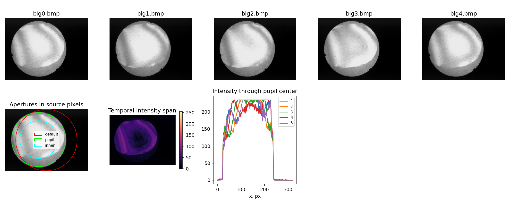

# PSI: разбор реальной серии big.idf

2 ноября 2026. Продолжение [уточнения неоднородного освещения](psi-illumination-refinement.md).
Параметры камеры, программы записи, экспозиции, гаммы и усиления неизвестны.
Поэтому серия рассматривается как проблемный вход, **не как эталон точности**.
Кадры и исходный IDF не изменены.

## Что подтверждено

### 1. Стандартная апертура не совпадает с изображением детали

Стандартный круг CLI: центр `(159,5;119,5)`, радиус 119 px. По границе яркого
диска оценены центр `(129,76;117,80)` и радиус 107,52 px. Для расчёта взят радиус
104,52 px с отступом 3 px от края. Это диагностическая геометрия для этой серии,
а не универсальный автоматический детектор апертуры.

В стандартной апертуре 16,4% отсчётов имеют яркость <=5; в исправленном круге
таких отсчётов нет. С исправленным кругом обычный PSI дал одну область развёртки
вместо двух. Однако покрытие карты осталось лишь **62,8% апертуры**, а расхождение
половин — 21,37°. Причину плохой достоверности одной маской не устранить.



Порог выделения диска 30 проверен также на 45 и 60. Центры отдельных кадров
при одном пороге отличаются менее чем на 0,1 px. Признаков крупного перемещения
силуэта нет; это не исключает субпиксельных смещений, поворота и изменения фазы
на неподвижном изображении.

### 2. В верхней части гистограммы есть выраженное плато

В исправленной апертуре **14,5% всех отсчётов точно равны 235**. У 43,2% пикселей
хотя бы один кадр достигает диапазона 233 и выше. При этом максимумы кадров
236–237, отсчёты 234 вообще отсутствуют в проверенных кадрах.

Такая структура совместима с ограничением/обработкой сигнала до записи BMP.
Она не доказывает насыщение именно сенсора и не устанавливает его физический
порог. Нельзя автоматически считать 235 белым уровнем камеры или восстанавливать
неизвестную гамму по этим пяти изображениям.

По точкам, реально выбранным решателем для оценки сдвигов, доля уровня 235
составляет **12,35%**. Это другая выборка, чем вся геометрическая апертура.

### 3. Текущая компенсация наклонов не улучшает модель этой серии

Одинаковая исправленная апертура и одинаковые исходные кадры:

| Режим | RMS невязки интенсивности | Расхождение половин | Области развёртки | Покрытие |
|---|---:|---:|---:|---:|
| Номинальный шаг 90° | 4,627 | 36,85° | 1 | 61,9% |
| Уточнение сдвигов/освещения | 4,035 | 21,37° | 1 | 62,8% |
| Существующий PSI с наклонами | 5,869 | 12,78° | 2 | 68,3% |

Большее покрытие и меньшее расхождение половин последнего режима не означают
меньшую ошибку фазы: невязка кадров выросла. Метод наклонов пока использует
исходные предположения Liu об освещении. Эти данные не доказывают ни наличие,
ни отсутствие физического наклона между кадрами.

Сужение круга до 70% радиуса также не сделало результат достоверным: изменились
найденные сдвиги и сохранилось расхождение половин. Сравнивать остаток S5 разных
апертур как одну и ту же метрологическую характеристику нельзя.

### 4. Простое исключение ярких пикселей не решает задачу

В независимой NumPy/SciPy-проверке после исключения всех точек с отсчётами >=233
осталось 13 934 точки. Свободная минимизация невязки сошлась, но дала почти
совпадающие сдвиги, обусловленность фазовой матрицы около 1922 и медианную
амплитуду свыше 12 тысяч уровней. Отношение сингулярных чисел системы информации
о сдвигах — `3,76e-13`.

Это вырожденное диагностическое решение, а не восстановленная фаза. Его нельзя
выбирать за меньшую невязку. Добавленный ранее guard в core предназначен именно
для отбрасывания такой недостаточности информации.

Проверена также простая гипотеза: подогнать фотометрию по трём и более отсчётам
ниже предполагаемого ограничения и проверить прогноз на отложенных ярких
отсчётах. При фиксированных сдвигах полного поля она не объяснила все данные:
только 68,5% проверенных пикселей согласовали все отложенные отсчёты с верхней
границей. RMS прогноза с последующим ограничением =15,18 против 4,51 у обычного
МНК на тех же 9960 пикселях. Это не оптимальная подгонка полной нелинейной модели
клиппинга; опыт лишь показывает, что простая экстраполяция не исправляет серию.
Делать вывод «всё вызвано только насыщением» оснований нет.

## Контроль на синтетике с известной фазой

Сгенерированы шесть кадров с точным шагом 60°, без движения, наклона, мерцания
и случайного шума. Для двух проблемных наборов введено только ограничение
интенсивности сверху: 235 или 255. Фаза сравнена с истиной после удаления
одного пистона развёртки, без подгонки знака, масштаба и наклона.

| Вход, уточнение включено | RMS ошибки фазы, периоды | Доля отсчётов на потолке |
|---|---:|---:|
| Чистая синусоида | 0,000388 | 0 |
| Ограничение на 235 | 0,002013 | 27,7% |
| Ограничение на 255 | 0,002013 | 27,7% |

В обрезанных сериях решатель сообщает сходимость, расхождение половин менее
1°, относительная невязка около 9,2%. То есть прежние общие пороги 10°/10%
не предупреждали, хотя ошибка фазы выросла более чем в пять раз.

## Изменение диагностики программы

Добавлен отдельный признак **возможного ограничения яркости**. По используемым
сигнальным точкам строится гистограмма. Подозрительным считается пик:

- в диапазоне уровней 192–255;
- не менее 5% отсчётов точно на одном уровне;
- более чем втрое выше каждого соседнего бина в пределах ±3;
- выше этого уровня находится не более 1% отсчётов.

Уровень не зафиксирован на 235. Предупреждение передаётся в GUI, панель PSI,
полный отчёт и CLI. Оно **не удаляет пиксели и не меняет фазу**; оператор получает
основание проверить запись. Изолированные горячие пиксели и чистая синтетика
защищены отдельными проверками от ложного срабатывания.

Это эвристика: размытое шумом насыщение и некоторые гамма-преобразования могут
не образовать узкого пика; необычная квантизация хороших данных может его создать.
Отсутствие предупреждения не подтверждает линейность камеры или годность карты.

Проверка изменения: полная сборка успешна, **13/13 CTest**, 43,44 с.
Добавлены четыре комбинации уровня ограничения/режима PSI и проверка одиночного
горячего пикселя; чистая серия предупреждение не вызывает. На реальном `big.idf`
CLI обнаружил уровень 235 с долей 12,3521% используемых отсчётов; русский
экспортированный отчёт содержит то же предупреждение.

## Как продолжать

Для проверки алгоритмов использовать синтетику с независимой известной фазой:
шум, неоднородное освещение, наклоны, ограничение яркости и пропуски по отдельности,
затем их сочетания. `big.idf` оставить для проверки предупреждений и устойчивости
к плохим входам. Для аттестации нужны новые кадры с известной процедурой записи
или другой реальный набор с подтверждёнными параметрами и эталоном.

С исходными сериями неизвестного качества нельзя обещать правильную абсолютную
форму, знак карты или пригодность для CAM путём подбора маски и фильтров.

## Артефакты и воспроизведение

- [Сравнение девяти запусков настоящего CLI](audit/psi-real-big-summary.json).
- [Независимая проверка ярких отсчётов](audit/psi-clipping-big-summary.json).
- [Шесть синтетических запусков и ошибки относительно истины](audit/psi-clipped-synthetic-summary.json).
- [Гистограмма и проверка простой модели ограничения](audit/psi-clipping-big.png).

```powershell
python notes/audit/psi_real_series.py notes/IDF/big.idf --output build/psi-real-big-corrected
python notes/audit/psi_clipping_probe.py notes/IDF/big.idf --output build/psi-clipping-big
python notes/audit/psi_clipped_synthetic.py
```

Для скриптов нужны NumPy, SciPy, Pillow, Matplotlib и собранный `psi_check`.
Локальные `notes/IDF/` не входят в Git. Синтетический опыт воспроизводится без них.
Сохранённые JSON — снимки до добавления нового предупреждения; повторный запуск
дополнительно печатает обнаруженный верхний пик.
