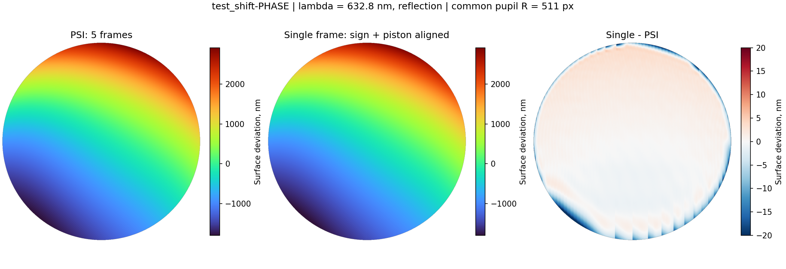

# Первый кадр против PSI по пяти кадрам: test_shift-PHASE

Сравнение выполнено на текущих DLL после исправления скачков трассировки.
Одиночный кадр — `test_data/psi_synthetic/test_shift-PHASE/1.bmp`;
серия — `1.idf` из той же папки.

## Одинаковые условия

- Без добавления поля и без автоматического подбора апертуры: круг с центром
  (511,5; 511,5), радиус 511 px на исходном изображении 1024×1024.
- Один кадр: Scanline Extremum → Horizontal Spline. Отдельно Max и MinMax.
  Дополнительное ручное продление (`--extend`) выключено.
- PSI: уточнение сдвигов и компенсация наклонов включены; номинальный шаг 90°.
- Физическая карта: λ = 632,8 нм, отражение, высота = фаза × 316,4 нм.
- S5: совместный МНК, базис Серегина, все доступные составляющие включены.

## Сравнение карт

В исходном результате знак одиночного восстановления противоположен PSI.
Косинусная интерферограмма сама по себе не различает φ и −φ. Для сравнения
формы знак одиночной карты изменён; затем согласован постоянный уровень
(пистон). Ни масштаб, ни наклон, ни аберрации для основной таблицы не подгонялись.
Общая область — 820248 точек с конечными значениями обеих карт.

| Метрика | Только максимумы (14 трасс) | Максимумы и минимумы (27 трасс) |
|---|---:|---:|
| RMS разности, общая апертура | 5,25 нм | 2,76 нм |
| PV разности, общая апертура | 76,17 нм | 34,15 нм |
| RMS разности внутри 90% радиуса | 1,85 нм | 1,05 нм |
| RMS разности внутри 80% радиуса | 1,22 нм | 0,94 нм |
| Наклон линейной регрессии single против PSI до смены знака | −1,00123 | −1,00084 |

90% радиуса — это 81% площади, а не 90% площади. В таблице для каждой
подобласти удалён её постоянный уровень. При дополнительном согласовании
наклона RMS MinMax составляет 2,47 нм на всей апертуре и 0,54 нм внутри
90% радиуса. Это отдельная метрика; наклон не удалялся в основной таблице.



На двух картах показаны высоты относительно общего среднего уровня.
Шкала разности ограничена ±20 нм для наглядности; численные метрики
вычислены по полным значениям без ограничения. Основные расхождения
сосредоточены у края апертуры и между трассами.

## Полиномиальный анализ

| Метрика S5 | PSI, 5 кадров | Один кадр, MinMax | Один кадр, Max |
|---|---:|---:|---:|
| RMS карты до вычитания полиномов | 1076,98 нм | 1078,05 нм | 1078,46 нм |
| RMS остатка | 0,08 нм | 1,78 нм | 3,59 нм |
| PV остатка | 0,86 нм | 27,72 нм | 62,28 нм |

Примеры коэффициентов, в порядках фазы; знак single согласован с PSI.
Это сырые коэффициенты базиса Серегина, не амплитуды из сводки DAPPSIM:

| Терм | PSI | Single MinMax |
|---|---:|---:|
| tiltX | 2,99155 | 2,99134 |
| tiltY | 5,97657 | 5,98444 |
| defocus | 0,99221 | 1,02785 |
| astigX | −0,66276 | −0,66270 |
| comaY | 1,98441 | 1,98900 |
| spherical | 0,99220 | 0,95111 |

На этой серии MinMax лучше согласуется с PSI, чем Max. Наклоны и основная
форма близки, но отдельные радиальные коэффициенты чувствительны к ошибкам
интерполяции у края. Малый остаток PSI не является доказательством абсолютной
точности: независимая эталонная карта здесь не использовалась. Это синтетические
данные; вывод о качестве реальных измерений из этих чисел не следует.

PSI сошёлся за 44 итерации: сдвиги 0 / 71,93 / 125,97 / 197,88 / 287,82°,
наклоны X 0 / 0,2 / 0,4 / 0,5 / 0,6; Y вниз 0 / −0,2 / 0,2 / −0,2 / −0,4.
Покрытие 99,9878%, одна область развёртки, фотометрическая невязка 0,181
уровня яркости. Условная оценка шума для модели с наклонами недоступна.

## Воспроизведение

К `terminal_pipeline` добавлены `--minmax`, `--out-map`, `--out-report`.
Текстовые карты совместимы с экспортом `psi_check`: первая строка — размеры,
затем фаза в периодах, `nan` — нет данных. Инструмент одиночного кадра нужно
запускать рядом с плагинами (`build/src`), как и само приложение.

```text
terminal_compare.exe test_data/psi_synthetic/test_shift-PHASE/1.bmp build/compare-single-psi/minmax.mtr --minmax --center-x=511.5 --center-y=511.5 --radius=511 --out-map=build/compare-single-psi/minmax.txt --out-report=build/compare-single-psi/minmax-report.txt
psi_check.exe test_data/psi_synthetic/test_shift-PHASE/1.idf --tilt --double-pass --center-x=511.5 --center-y=511.5 --radius=511 --out-map=build/compare-single-psi/psi.txt --out-report=build/compare-single-psi/psi-report.txt
```

Для Max убрать `--minmax` и изменить имена выходных файлов. Результаты,
журналы и `metrics.json` находятся в `build/compare-single-psi/`.
