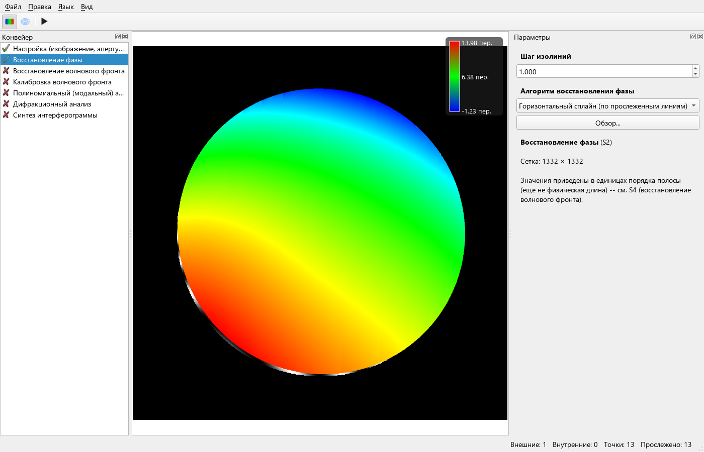

# SCAN360: исправление нумерации и проверка карты фазы

Последующее исправление оставшихся краевых ошибок и новые метрики:
[Восстановление края зрачка](scan360-rim-2026-11-03.md).

Предыдущая проверка SCAN360 контролировала геометрию гребней, но была
недостаточна для проверки восстановленной фазы. Пользовательский скриншот
выявил проблему на следующем этапе: правильные линии получили неверные номера.

## Причины и изменения

- Общая функция `autoAssignFringeOrder` сортировала линии по среднему X.
  У горизонтальных изогнутых полос средний X зависит от того, как апертура
  обрезала концы. Он не определяет фазовый порядок. Теперь соседство
  определяется по пересечениям трасс с общими строками или столбцами,
  а номера распространяются по наиболее подтверждённым связям соседства.
  Ручные номера сохраняются. Если граф не связывает весь набор, остаётся
  старый запасной порядок; замкнутые/несвязные контуры этим не решены.
- Цветная карта была полупрозрачной вне PSI: через неё просвечивали исходные
  полосы. Теперь карта непрозрачна для всех методов. Это изменение отображения,
  оно не меняет массив фазы и не скрывает ошибки численной реконструкции.
- В `terminal_pipeline` добавлен `--sequential` для воспроизведения пути
  «авторасстановка точек → SCAN360 → горизонтальный сплайн».

## Численная проверка

Первый кадр `test_shift-PHASE/1.bmp`, центр (511,5; 511,5), радиус 511 px,
без дополнительного поля; 13 начальных точек и 13 трасс. Одинаковые трассы
до и после изменения нумерации. Сравнение с PSI пяти кадров из предыдущего
прогона, λ = 632,8 нм, отражение (316,4 нм/период).
Для сравнения согласованы знак и постоянный уровень; масштаб не подгонялся.

| Метрика | До | После |
|---|---:|---:|
| RMS разности с PSI, общая апертура | 167,83 нм | 14,57 нм |
| RMS разности с PSI, внутри 90% радиуса | 101,55 нм | 7,02 нм |
| RMS остатка S5 | 154,38 нм | 7,49 нм |
| PV остатка S5 | 2448,13 нм | 95,89 нм |

В GUI с автоапертурой выполнен полный проход до S5: RMS остатка 7,84 нм,
PV остатка 375,73 нм. Это не та же апертура, что в численной таблице;
большой краевой PV показывает, что края SCAN360 ещё требуют улучшения.
Нумерация исправлена, но результат не стал эквивалентен PSI или MinMax FTM.
Один поперечный ряд стартов не гарантирует обнаружение всех краевых полос.

Добавлены регрессионные тесты: нумерация изогнутых трасс с разной обрезкой
концов и сквозной проход настоящих DLL SCAN360 и Horizontal Spline на
синтетике с известной фазой. Последний проверяет модуль масштаба (допуск 2%)
и RMS формы внутри зрачка (меньше 0,05 периода), а не только яркость гребней.
Смена знака при сравнении допустима из-за неоднозначности одиночной
косинусной интерферограммы; это не калибровка физического знака поверхности.

Файлы расчётов — `build/compare-single-psi/scan360-before*` и
`scan360-after*`; снимок GUI — `build/ui-scan360-phase-result.png`.
