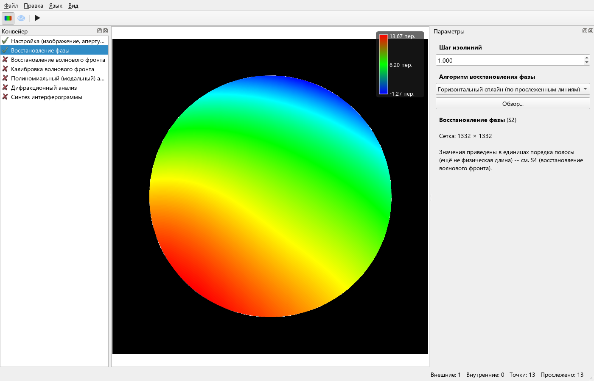

# SCAN360: восстановление края зрачка

Продолжение [проверки нумерации](scan360-phase-order-2026-11-03.md).
После правильной нумерации оставались выбросы около края, особенно при
использовании автоапертуры.

## Изменения

1. SCAN360 больше не добавляет в измеренную трассу точку пересечения
   прогнозного направления с апертурой или неподтверждённый прогноз после
   отказа центрирования. Такие точки не являются найденными максимумами.
2. Horizontal Spline интерполирует остаток относительно общей полиномиальной
   формы степени до четырёх, затем полностью возвращает эту форму. Это
   предобусловливание интерполяции: наклоны и аберрации остаются в карте S2,
   вычитание выбранных аберраций выполняется отдельно на S5.
3. Форма оценивается по координатам и номерам трасс с помощью QR с выбором
   столбцов. Координаты нормированы; при недостаточном ранге последовательно
   пробуются квадратичная и линейная формы, затем нулевой тренд.
4. В строках без достаточного числа пересечений край продолжается по локально
   оценённому наклону остатка. Раньше копировалось постоянное значение соседней
   строки. Поддержка через невидимые разрывы апертуры не переносится.
5. При равномерном фоне автоапертура теперь определяется непосредственно
   по контрасту относительно фона. Дисперсионное окно расширяло область
   активности за настоящий край; этого было достаточно для больших выбросов
   в S5. Для неоднородного фона сохранён прежний дисперсионный метод.

Изменение Horizontal Spline относится ко всем трассировщикам, использующим
этот плагин, а не только к SCAN360. PSI не использует эту интерполяцию.

## Проверка на test_shift-PHASE/1.bmp

λ = 632,8 нм, отражение; после вычитания всех включённых аберраций S5:

| Сценарий | RMS до | RMS после | PV до | PV после |
|---|---:|---:|---:|---:|
| Точная апертура, центр 511,5; радиус 511 px | 7,49 нм | 1,99 нм | 95,89 нм | 34,46 нм |
| Полный проход через UI с автоапертурой | 7,84 нм | 1,80 нм | 375,73 нм | 34,18 нм |

На точной апертуре RMS разности карты с PSI пяти кадров после согласования
знака и постоянного уровня снизился с 14,57 до 2,10 нм; внутри 90% радиуса —
с 7,02 до 1,66 нм. Масштаб и наклоны при этом сравнении не подгонялись.

## Регрессионные проверки

- Плоскость, квадратичная и четвертая степень на известной фазе: трассы
  намеренно заканчиваются до края зрачка, проверяется вся видимая апертура.
- Недостаточный ранг на двух трассах: проверяется переход к линейной форме.
- Неполиномиальная фаза с синусоидой и локальным гауссовым дефектом:
  проверяются RMS внутри зрачка и сохранение вершины локального дефекта.
- Для автоапертуры допуск на полуоси синтетического зрачка ужесточён до
  3 px на изображениях 256 и 825 px.
- Полная рабочая сборка и CTest; Terminal сравнивается с `Terminal_digit.mtr`.

Все 15 наборов CTest прошли. У контрольной разности Terminal после S5
RMS сохранился 9,47 нм, PV изменился с 47,01 до 46,53 нм. Влияние нового
восстановления проверено и на другом изображении, а не только на `1.bmp`.
Release и архив поставки не пересобирались.

За последними достоверными трассами значение фазы остаётся экстраполяцией,
а не независимым измерением. Эти результаты проверены на данной синтетике;
они не задают абсолютную точность метода на произвольных реальных данных.

Численные промежуточные прогоны лежат в `build/compare-single-psi/scan360-edge-*`.
Итоговый вариант — `edge-e` (переход к QR сохраняет приведённые округлённые
метрики). Снимки UI — `build/ui-scan360-phase-result.png` и
`build/ui-scan360-modal-result.png`.
